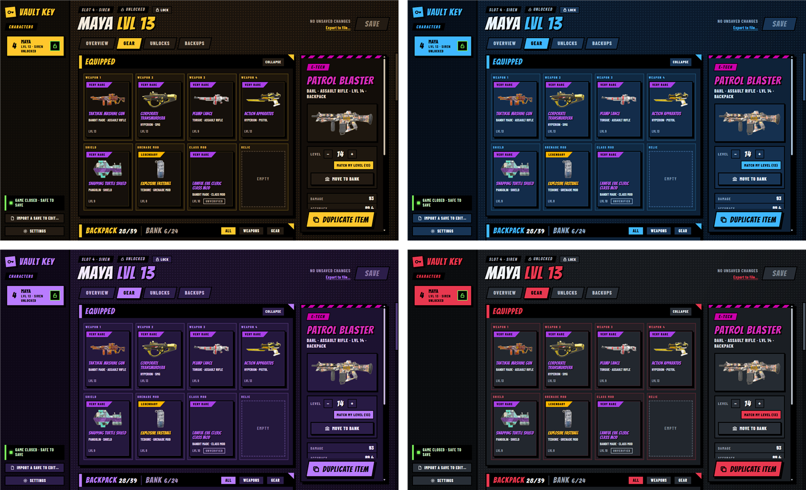
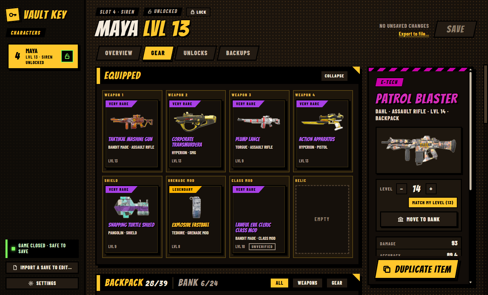
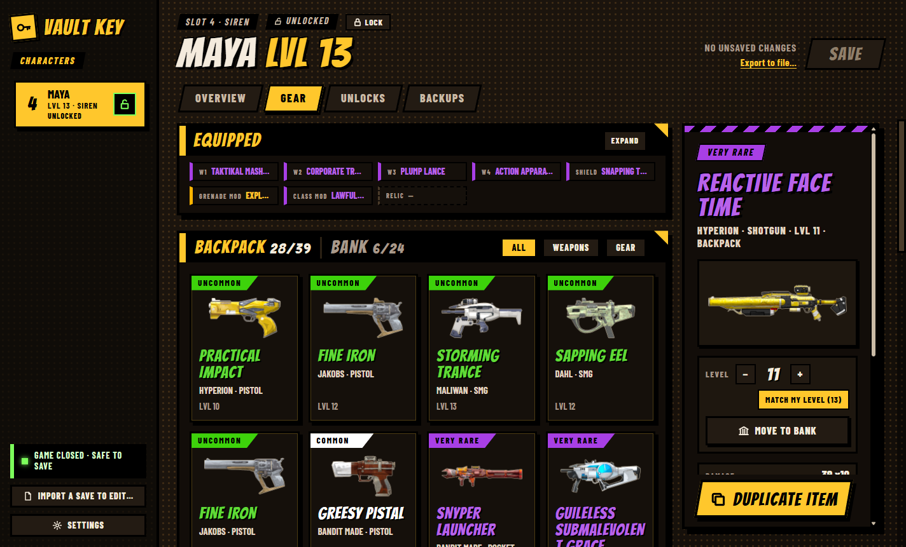
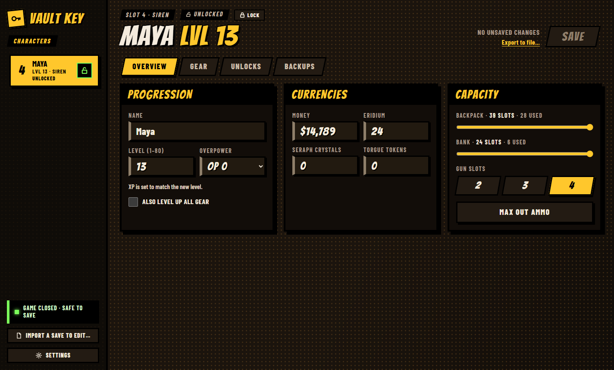
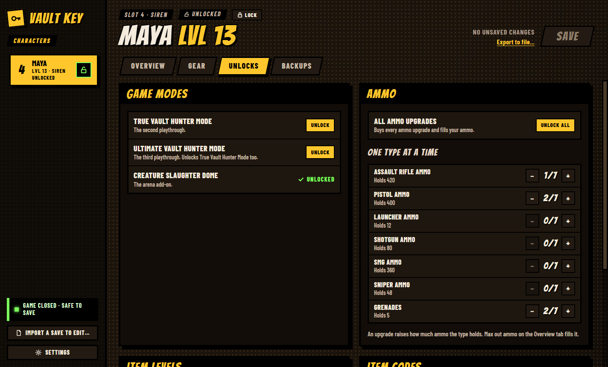
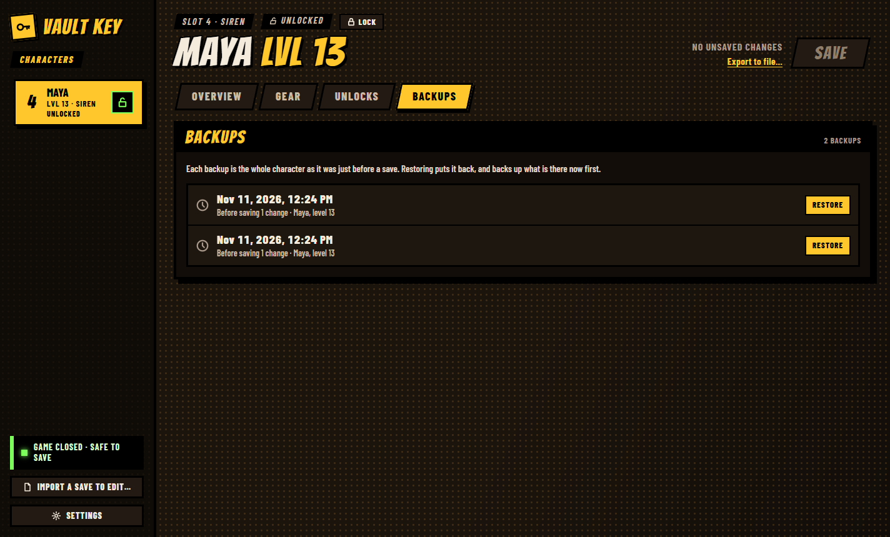
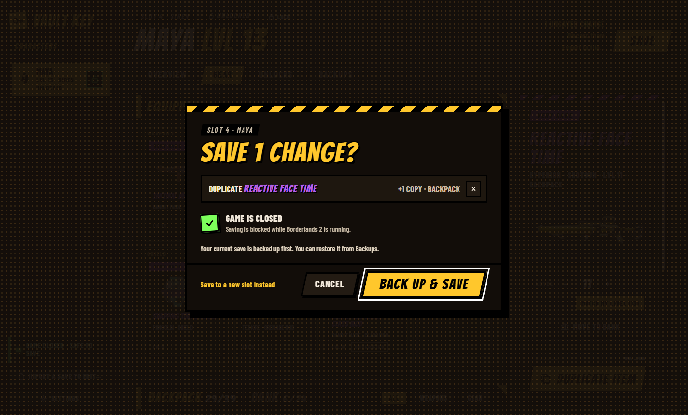
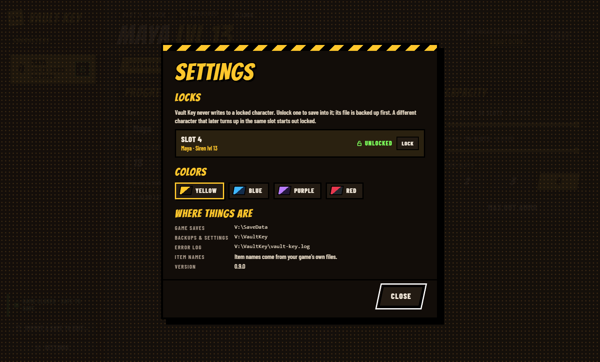

<p align="center">
  
</p>

<h1 align="center">Vault Key</h1>

<p align="center">
  A save editor for Borderlands 2 on PC.<br>
  Level, money and gear, plus item duplication for sharing loot with friends.
</p>

<p align="center">
  <a href="https://github.com/SInsanali/vault-key/releases/latest"></a>
  
  
  <a href="LICENSE"></a>
</p>

<p align="center">
  <a href="https://github.com/SInsanali/vault-key/releases/latest"><b>Download</b></a>
</p>



<p align="center"><sub>Four color themes: yellow, blue, purple and red.</sub></p>

<br>

## Features

- **Gear:** every item with its real name, card and picture, read from your copy of the game.
- **Duplicate** any weapon, shield, grenade mod or class mod.
- **Item levels:** set one item's level, or match it to your character.
- **Backpack and bank:** move items between them, and set either one's size.
- **Character:** level, money, Eridium, Seraph crystals, Torgue tokens and gun slots.
- **Unlocks:** True and Ultimate Vault Hunter Mode, and ammo upgrades.
- **Any save file:** open one from anywhere and export a character to a file.

<br>

## A look around



<table>
  <tr>
    <td width="50%"><br><sub><b>Backpack and bank</b></sub></td>
    <td width="50%"><br><sub><b>Overview</b>: level, currencies and capacity</sub></td>
  </tr>
  <tr>
    <td><br><sub><b>Unlocks</b>: game modes and ammo</sub></td>
    <td><br><sub><b>Backups</b>: restore any earlier save</sub></td>
  </tr>
  <tr>
    <td><br><sub><b>Review</b> every change before it's written</sub></td>
    <td><br><sub><b>Settings</b>: locks, colors and file locations</sub></td>
  </tr>
</table>

<br>

## Built to be safe

- Every save is backed up first, and any backup can be restored.
- Every change is shown before it's written.
- Characters from the game start locked until you unlock them.
- Vault Key won't save while Borderlands 2 is running.

<br>

## Install

Download **`VaultKey-Setup-0.9.0.exe`** from the
[latest release](https://github.com/SInsanali/vault-key/releases/latest) and run it. No
administrator rights needed. Prefer not to install? Grab the portable zip instead.

> [!NOTE]
> The installer isn't code-signed yet, so SmartScreen may warn you the first time.
> Choose **More info → Run anyway**.

**Requirements**

- Windows 10 or 11, 64-bit.
- Borderlands 2 installed through Steam. Without it, saves still open, but items show no
  names or pictures.

> [!TIP]
> If Steam Cloud asks which save to keep after an edit, pick the local one.

<br>

## Known gaps

- Golden Keys and Badass tokens can't be edited yet.
- Some add-on items are marked "Unverified" and can't be duplicated yet.
- Gaige and Krieg class mods, skins and heads have no pictures.

**Found a bug?** [Open an issue](https://github.com/SInsanali/vault-key/issues) and include
the last lines of the error log (its location is under **Settings → Where things are**).
Please don't attach save files to a public issue: they contain your Steam ID.

<br>

## Building

A Rust workspace with a WebView2 front end in `ui/`, built for `x86_64-pc-windows-gnullvm`.
See `.github/actions/toolchain` for the setup.

```
cargo test --workspace
cargo build --release -p vault-key
```

`packaging/package.ps1` builds the installer (Inno Setup 7) and the portable zip.

<br>

## License

[MIT](LICENSE). Bundled fonts and crates are listed in
[THIRD_PARTY_NOTICES.md](THIRD_PARTY_NOTICES.md).

<sub>Vault Key is a fan project, not affiliated with Gearbox Software or 2K. It ships no game
files; names and pictures are read from your own installed copy.</sub>
