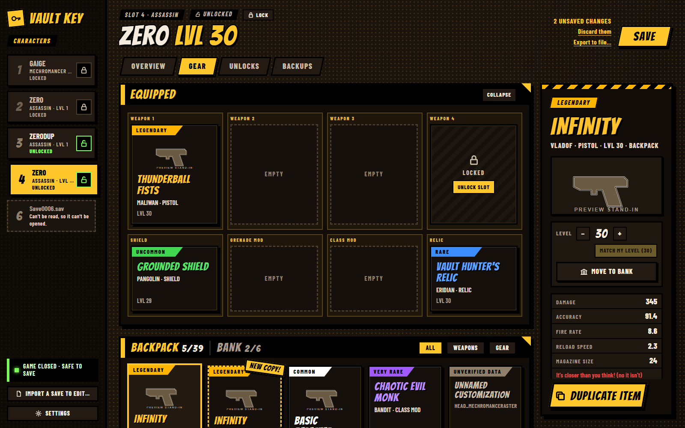
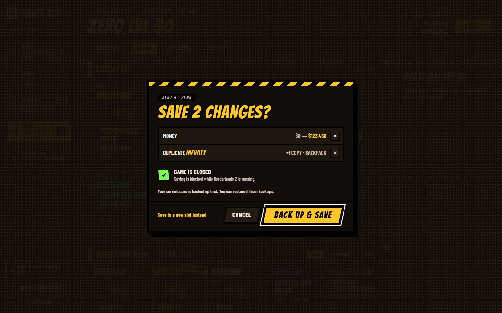

# Vault Key

A save editor for Borderlands 2 on Windows. Change a character's level, money and gear, and
duplicate an item so you can hand the copy to a friend in co-op. Your friend needs nothing
installed.





The pictures above use stand-in drawings. The app shows each item's real name, card and
picture, read from your own copy of the game.

## Download and install

Get `VaultKey-Setup-<version>.exe` from the
[latest release](https://github.com/SInsanali/vault-key/releases/latest) and run it. It
installs for your Windows account only and does not ask for administrator rights.

The installer is not code-signed, so Windows SmartScreen may show "Windows protected your PC"
the first time. Choose **More info**, then **Run anyway**.

Vault Key is then in the Start menu. To keep it on the taskbar, right-click it in the Start
menu and choose **Pin to taskbar**.

If you would rather not install anything, download `VaultKey-<version>-portable.zip`, unpack
it anywhere, and run `vault-key.exe`.

`SHA256SUMS.txt` in each release lists the checksums of both downloads.

## What it needs

- Windows 10 or 11, 64-bit.
- Borderlands 2 for PC on Steam, installed on the same PC. Item names, cards and pictures
  come from the game's own files. Without the game, Vault Key still opens save files, but
  items have no names.
- The Microsoft Edge WebView2 Runtime. Windows 11 and current Windows 10 already have it. The
  installer adds it if it is missing.

## What it does

- Edits level, money, Eridium, Seraph crystals, Torgue tokens, backpack and bank size, ammo
  upgrades and weapon slots.
- Duplicates an item, sets one item's level, and moves items between the backpack and the bank.
- Opens a save file from anywhere, such as one a friend sent you, and exports a character to
  a file.

## How it keeps your saves safe

- Characters you made in the game start locked. Vault Key does not change a character's file
  until you unlock that character. A locked character can still be copied to a new slot and
  edited there.
- Before every save, Vault Key makes a backup of the file. The Backups tab restores any of them.
- It does not save while the game is running.
- You review every change before it is written, and the written file is read back and checked.
- The game's own files are only ever read.

If Steam Cloud asks which save to keep after you edit one, choose the local files.

## Uninstall

Use **Settings → Apps → Installed apps → Vault Key → Uninstall**, or the uninstaller in the
program folder. This removes the program and its shortcuts.

The uninstaller asks whether to also delete Vault Key's own data folder
(`%LOCALAPPDATA%\VaultKey`). That folder holds your settings and the backups of your saves,
and it is kept unless you say otherwise. Your game saves are never touched.

## Known gaps

- Class mods for Gaige and Krieg have no pictures. Story and mission items have none by design.
- Skins and heads show "No game data".
- Some items from add-on content are marked "Unverified" and cannot be duplicated yet.
- Moving an item from the bank to the backpack has not been checked in the game yet. Moving
  to the bank, item levels and ammo upgrades have.
- Golden Keys and Badass tokens cannot be edited yet.

## Problems

Vault Key writes errors to a log file. Settings shows where it is, under "Where things are".
When you [report a problem](https://github.com/SInsanali/vault-key/issues), include the last
lines of that log. Please do not attach save files to a public issue: they hold your Steam ID.

## Building from source

Vault Key is a Rust workspace with a web UI in `ui/`, shown in a WebView2 window. It builds
with stable Rust for the `x86_64-pc-windows-gnullvm` target. `.github/actions/toolchain` shows
the exact setup; `scripts/` holds the helpers for building from WSL.

```
cargo test --workspace
cargo build --release -p vault-key
```

`packaging/package.ps1` builds the installer (Inno Setup 7) and the portable zip.

Some comments in the code point to notes under `docs/research` and `docs/format`. Those are
working notes and are not part of this repository.

## License and credits

Vault Key is released under the [MIT License](LICENSE). The fonts and Rust crates it includes
are listed in [THIRD_PARTY_NOTICES.md](THIRD_PARTY_NOTICES.md).

Vault Key is a fan-made tool. It is not affiliated with or endorsed by Gearbox Software or
2K. Borderlands is a trademark of its owners. Vault Key ships no game files: names, cards
and pictures are read from your own installed copy of the game.
